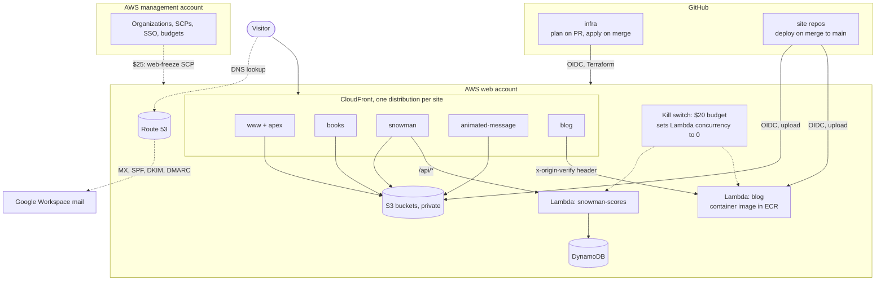

# infra

Terraform for www.mikemjharris.com and its subdomains on AWS: static sites in S3 behind CloudFront, the blog
on Lambda, DNS in Route 53. Each site's own repo deploys its content with GitHub Actions.

- `docs/aws-migration-plan.md`: the plan for moving off the old DigitalOcean droplet.
- `bin/terraform`: runs Terraform from the pinned `hashicorp/terraform` Docker image, using AWS credentials
  from the host's AWS CLI (`aws sso login`, profile from each layer's `.aws-profile`). Use it like `terraform`, from anywhere in the repo.

## Architecture

- Every site is served by CloudFront from a private S3 bucket, except the blog, which runs on Lambda. The
  blog's Lambda and the snowman scores API only answer requests carrying CloudFront's secret
  `x-origin-verify` header, so their function URLs can't be called directly.
- GitHub Actions reaches AWS through OIDC roles; no AWS keys are stored in GitHub.
- Cost guards: a $1/day and anomaly alert (org), a $20/month web budget that sets every Lambda's
  concurrency to 0, and a $25/month budget action that attaches the `web-freeze` SCP to the web account.

## Layers

| Folder | Account | State | What |
|---|---|---|---|
| `terraform/org` | management | applied | organisation, `workloads` OU, `web` account, guard-rail SCPs, SSO access, budgets, cost anomaly alert, `web-freeze` SCP |
| `terraform/web/bootstrap` | web | applied | state bucket, GitHub OIDC provider, `github-infra-plan` / `github-infra-apply` roles, budget kill switch |
| `terraform/web/dns` | web | applied, live | Route 53 zone (fixed nameservers), mail records (MX, SPF, DKIM, DMARC), CAA |
| `terraform/web/sites` | web | applied, live | www, blog (Lambda), books, snowman (+ scores API), animated-message, dashboard deploy role, `version.json` CORS |
| `terraform/github` | GitHub (state in web) | applied | the site repos and `config`: rebase-only merges, secret scanning, rules on `main` (PR, CI checks, linear history), infra's `production` environment |

Each folder's `.aws-profile` names the AWS CLI profile `bin/terraform` uses there.

## Changing it

`main` is protected (in every site repo, by `terraform/github`): changes go through pull requests, merged by
rebase, and the `Terraform plan` check must pass.

- **Pull request:** GitHub Actions plans each `terraform/web/*` layer the PR touches (module changes plan
  `web/sites`) and posts the plan as a comment. It uses the read-only `github-infra-plan` role.
- **Merge to `main`:** the same layers are applied in order (bootstrap, dns, sites) in the `production`
  environment with the `github-infra-apply` role, after checking the commit is the merge of a pull request.
- **Weekly (Mondays):** every web layer is planned; the run fails if anything was changed outside Terraform.
- **`terraform/org`** (management account) isn't in CI: the CI roles live in the web account and can't reach
  it. Apply it by hand with `bin/terraform` and an SSO login to the management account.
- **`terraform/github`** isn't in CI either (it would need a GitHub token with admin on every repo). Apply it
  by hand; `bin/terraform` uses the GitHub CLI's login (`gh auth token`) and the web profile for state.
- To try things out locally: `bin/terraform plan` in a layer folder (needs `aws sso login --profile web`).

## Notes

- The `www` bucket also holds `/dashboard/` and `/lighthouse/`, which aren't in the `personal-website` repo.
  Its deploy must exclude them (`aws s3 sync --delete --exclude 'dashboard/*' --exclude 'lighthouse/*'`).
